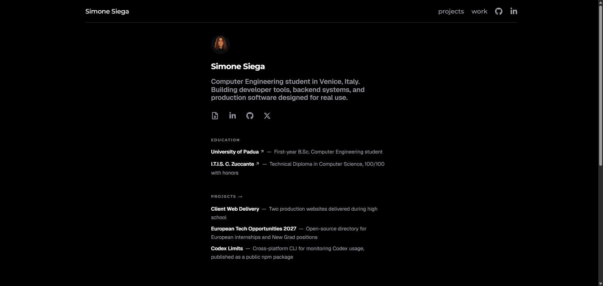

<div align="center">

# Simone Siega

**Computer Engineering student based in Venice, Italy.**

I build thoughtful software, explore complex systems, and turn ideas into products people can use.

[Portfolio](https://simonesiega.com) · [GitHub](https://github.com/simonesiega) · [LinkedIn](https://linkedin.com/in/simonesiega)

<br />

<a href="https://simonesiega.com">
  
</a>

</div>

## About

This repository contains the source for [simonesiega.com](https://simonesiega.com), my personal portfolio and a home for selected work, experience, and ideas.

## Stack

Next.js 16 · React 19 · TypeScript · Tailwind CSS 4 · MDX · Bun

## Run Locally

Use Node 26 (`.node-version`) and the Bun version pinned in `package.json`.

```bash
git clone https://github.com/simonesiega/portfolio.git
cd portfolio
bun install --frozen-lockfile
bun run dev
```

Open [localhost:3000](http://localhost:3000).

## Commands

| Command                          | Description                                                   |
| -------------------------------- | ------------------------------------------------------------- |
| `bun run dev`                    | Start the local development server                            |
| `bun run build:local`            | Build with the portfolio's canonical origin                   |
| `bun run build`                  | Build with a configured production origin                     |
| `bun run build:standalone:local` | Build and copy assets for standalone preview                  |
| `bun run start`                  | Serve the standalone production build                         |
| `bun run check`                  | Run formatting, linting, type checks, unit tests, and a build |
| `bun audit`                      | Audit direct and transitive dependencies                      |
| `bun run test`                   | Run unit tests                                                |
| `bun run test:e2e --workers=2`   | Run the Chromium, Firefox, and WebKit suites                  |
| `bun run format`                 | Format the codebase                                           |

For `bun run build`, set `NEXT_PUBLIC_SITE_URL` or `SITE_URL` at build time; the public value takes precedence. See [`.env.example`](.env.example) for configuration names. `NEXT_PUBLIC_*` values are public and embedded in the build, not secrets. Analytics is disabled unless explicitly enabled.

Before running browser tests, install Chromium, Firefox, and WebKit (add `--with-deps` on Linux):

```bash
bunx playwright install chromium firefox webkit
```

E2E builds and starts its own standalone server on port **3100**, with analytics disabled and CSP enforced. Do not run it alongside another build or development server in the same worktree: they share `.next`.

## Project Structure

```text
src/app                 Routes, metadata, sitemap, and pages
src/components          Reusable interface and animation components
src/lib/config/text     Portfolio content and project data
src/styles              Design, motion, and accessibility styles
e2e                     End-to-end and accessibility tests
public                  Images, media, and résumé
.github/workflows       Build, quality, test, and security automation
```

## License

Released under the [MIT License](LICENSE).
